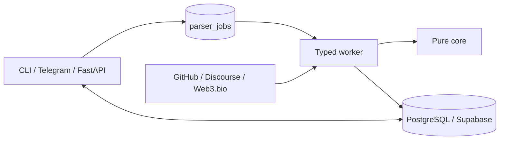

# Crycon

**Evidence-first backend for researching public Web3 profiles.**

[](https://www.python.org/)
[](https://fastapi.tiangolo.com/)
[](https://www.postgresql.org/)
[](#tests)

[Architecture](docs/ARCHITECTURE.md) · [Demo](docs/DEMO.md) ·
[Roadmap](docs/ROADMAP.md) · [Security](docs/SECURITY.md)

## О проекте

Crycon собирает сигналы из публичных Web3-профилей, сохраняет подтверждающие
источники и рассчитывает объяснимый confidence score. Проект помогает исследовать
возможные связи между профилями на разных платформах, не выдавая эвристику за
доказательство личности.

> Confidence score показывает силу совпадения публичных сигналов. Он не доказывает
> личность человека, владение кошельком или противоправные действия.

### Что умеет backend

- искать кандидатов в GitHub и публичных Discourse-форумах;
- обогащать профили контактами, usernames, ENS и публично указанными кошельками;
- связывать сигналы через Web3.bio и хранить evidence вместе с источником;
- рассчитывать score с детальным breakdown и версионированными policy;
- отдавать кандидатов, evidence и поиск через typed FastAPI;
- выполнять долгие операции через durable PostgreSQL jobs;
- переживать повторную доставку задач благодаря idempotency key, lease и retry;
- тестировать миграции на настоящем PostgreSQL без production-доступа.

## Почему проект интересен технически

Crycon начинался как набор работающих CLI-скриптов. Дальнейшая задача была не
«переписать всё», а постепенно выделить production-like границы, сохранив прежнее
поведение.

| Проблема | Решение |
|---|---|
| Сеть, БД и scoring были смешаны | Чистый core в `src/crycon`, side effects на границах |
| CLI напрямую зависел от Supabase | Repository protocol и Supabase adapter |
| Fuzzy search дублировал результаты и устаревал | Живой поиск, один rank на candidate |
| Три REST-вставки оставляли частичные данные | Одна транзакционная PostgreSQL function |
| Долгие операции запускались из HTTP/бота | Typed jobs и отдельный worker |
| Повтор job мог продублировать работу | Idempotency key, `SKIP LOCKED`, lease и retry |
| Старые формулы расходились | Обе policy названы и покрыты regression-тестами |

Подробные причины и компромиссы: [Architecture](docs/ARCHITECTURE.md) и
[технический аудит](docs/AUDIT.md).

## Архитектура



FastAPI ставит долгую операцию в очередь и сразу возвращает `202`. Worker атомарно
забирает job, вызывает typed handler и завершает её только при совпадении lease.
Чистый core не импортирует Supabase, HTTP-клиенты или окружение.

## Стек

- Python 3.11, FastAPI, Pydantic, Uvicorn;
- PostgreSQL 16, Supabase SDK, SQL migrations, `pg_trgm`;
- pytest, fake adapters и PostgreSQL integration tests;
- Dockerfile, Docker Compose и GitHub Actions;
- Telegram Bot API, GitHub API, Discourse и Web3.bio.

## Быстрый локальный старт

Docker runtime проверен на Windows 11, WSL2 и Ubuntu 26.04. Для Python-запуска:

```bash
python3.11 -m venv .venv
source .venv/bin/activate
python -m pip install -r requirements-dev.txt
cp .env.example .env
python -m pytest -q
uvicorn crycon.api:app --reload
```

После запуска Swagger UI доступен на <http://127.0.0.1:8000/docs>, liveness — на
`/health`, readiness — на `/ready`. Импорт приложения, OpenAPI и `/health` не
требуют credentials; data endpoints требуют настроенного storage.

### Docker Compose

```bash
docker compose up --build api worker bot
docker compose --profile integration up -d postgres-test
docker compose --profile integration run --rm test
```

API публикуется только на `127.0.0.1:8000`. `postgres-test` — отдельная база для
integration-тестов. Сервис `test` ждёт healthy PostgreSQL и запускает полный suite
в отдельном Python 3.11 image. `bot` запускает Telegram polling и требует
`TELEGRAM_BOT_TOKEN` в `.env`; `TELEGRAM_ALLOWED_USER_IDS` можно задать как
необязательное ограничение доступа.

На Windows/WSL после первого `git pull` дальнейшее обновление runtime выполняется
одной командой:

```bash
./update.sh
```

Скрипт делает только fast-forward pull, проверяет Compose, пересобирает `api`,
`worker` и `bot`, затем показывает состояние контейнеров. Локальный `.env` остаётся
на Windows и не попадает в Git.

### Mini App

Откройте `miniapp/index.html` в браузере для демо на синтетических данных.
С запущенным API страница `http://127.0.0.1:8000/miniapp/` использует
его поиск, список и карточки кандидатов. История задач остаётся за админским API.

Для временного HTTPS-превью в WSL нужен Docker Desktop, рабочий `.env` с
`TELEGRAM_BOT_TOKEN`, `SUPABASE_URL` и `SUPABASE_KEY`.

```bash
bash miniapp-preview.sh
```

Скрипт поднимает отдельный API с Telegram-авторизацией, получает временный
HTTPS-адрес Cloudflare и пересоздаёт контейнер бота с этим адресом. После запуска
отправьте боту `/start` в личном чате и нажмите **Open Crycon**. Telegram
передаёт подписанные данные запуска, действительные до часа. Если
`TELEGRAM_ALLOWED_USER_IDS` пуст, доступ есть у любого, кто откроет приложение
через этого бота. Для публичного демо используйте синтетические данные.

Адрес меняется при каждом запуске скрипта. После обычного `./update.sh` повторно
запустите скрипт, чтобы вернуть кнопку превью. Остановить превью можно командой
`docker compose --profile miniapp stop miniapp-tunnel miniapp-api`.

## API

| Method | Endpoint | Назначение |
|---|---|---|
| `GET` | `/health` | Liveness без обращения к БД |
| `GET` | `/ready` | Проверка storage |
| `GET` | `/candidates` | Пагинация кандидатов |
| `GET` | `/search?q=alice` | Ranked search |
| `GET` | `/candidates/{id}` | Candidate, profiles, contacts, wallets |
| `GET` | `/candidates/{id}/evidence` | Evidence отдельным ресурсом |
| `POST` | `/jobs` | Идемпотентная постановка typed job |
| `GET` | `/jobs` | Список job |
| `GET` | `/jobs/{id}` | Attempts, lease и ошибка |

Job endpoints закрыты `X-API-Key`:

```bash
curl -X POST http://127.0.0.1:8000/jobs \
  -H 'Content-Type: application/json' \
  -H 'X-API-Key: replace-with-admin-key' \
  -H 'Idempotency-Key: discovery-demo-01' \
  -d '{"job_type":"discovery","keywords":["validator"],"max_attempts":3}'
```

Поддержаны `discovery`, `contact_enrichment`, `wallet_enrichment`,
`score_recalculation` и `identity_resolution`.

## CLI

```bash
# чтение
python search_candidate.py alice
python search_candidate.py --top 20 --full

# внешние запросы и/или запись
python parse_web3_to_supabase.py
python worker.py --loop
python enrich_to_supabase.py --limit 10
python resolve_identity.py @alice
python wallet_deep_enrich.py --id 44
python recalculate_scores.py --id 44 --explain
python bot.py
```

`--explain` показывает JSON breakdown, но не является dry-run: score сохраняется.

## Database migrations

Миграции применяются по порядку только к отдельной dev/staging базе:

1. `schema_v1.sql` — исходная модель;
2. `002_search_improvements.sql` — trigram indexes и исторический fuzzy search;
3. `003_live_unique_search.sql` — живой уникальный поиск;
4. `004_storage_integrity.sql` — атомарный discovery и constraints;
5. `005_parser_job_lifecycle.sql` — durable job lifecycle.
6. `006_api_security.sql` — RLS и backend-only grants по умолчанию.

`schema_v1.sql` и `002` нельзя повторно запускать вслепую. Миграции `003–006`
идемпотентны и проверены integration-тестами. Полная цепочка также применена к
отдельному Supabase staging; production-база не изменялась.

## Tests

```bash
python -m compileall -q src tests *.py
python -m pytest -q
python -m pip check
```

Локально проверено на Python 3.11 и PostgreSQL 16.16:

- **130** offline unit/contract tests;
- **10** PostgreSQL integration tests;
- **140 passed** в полном прогоне;
- network и DNS заблокированы для unit-тестов;
- production credentials и реальные API не используются.

Integration fixture создаёт случайную schema, применяет миграции и удаляет её:

```bash
CRYCON_TEST_DATABASE_URL=postgresql://127.0.0.1/crycon_test \
  python -m pytest -q tests/integration
```

## Статус и ограничения

Готовы core, repository layer, API, jobs, worker, миграции, тесты, CI и Docker
runtime на Windows/WSL2. На отдельном Supabase staging применена цепочка до `006`,
проверены RLS/grants, readiness, идемпотентная job и worker restart. Ещё не проверены
нагрузка поиска, реальные discovery API/rate limits, hard-crash recovery и Telegram.

В прежней Git-истории находились credentials. Текущий `.env` удалён, но старые
значения считаются скомпрометированными. Ротация и очистка истории выполняются
владельцем отдельно: [Security runbook](docs/SECURITY.md).

## Документация

- [Architecture and engineering decisions](docs/ARCHITECTURE.md)
- [Five-minute demo](docs/DEMO.md)
- [Roadmap and definition of done](docs/ROADMAP.md)
- [Full technical audit](docs/AUDIT.md)
- [Scoring policies](docs/SCORING.md)
- [Credential rotation](docs/SECURITY.md)

## Принципы проекта

- evidence важнее одного «магического» числа;
- score имеет название policy и объяснимый breakdown;
- HTTP не выполняет долгую работу внутри request lifecycle;
- внешние сервисы заменяются fake-реализациями в unit-тестах;
- изменения схемы оформляются новыми миграциями;
- непроверенные свойства явно отмечаются, а не выдаются за готовые.
