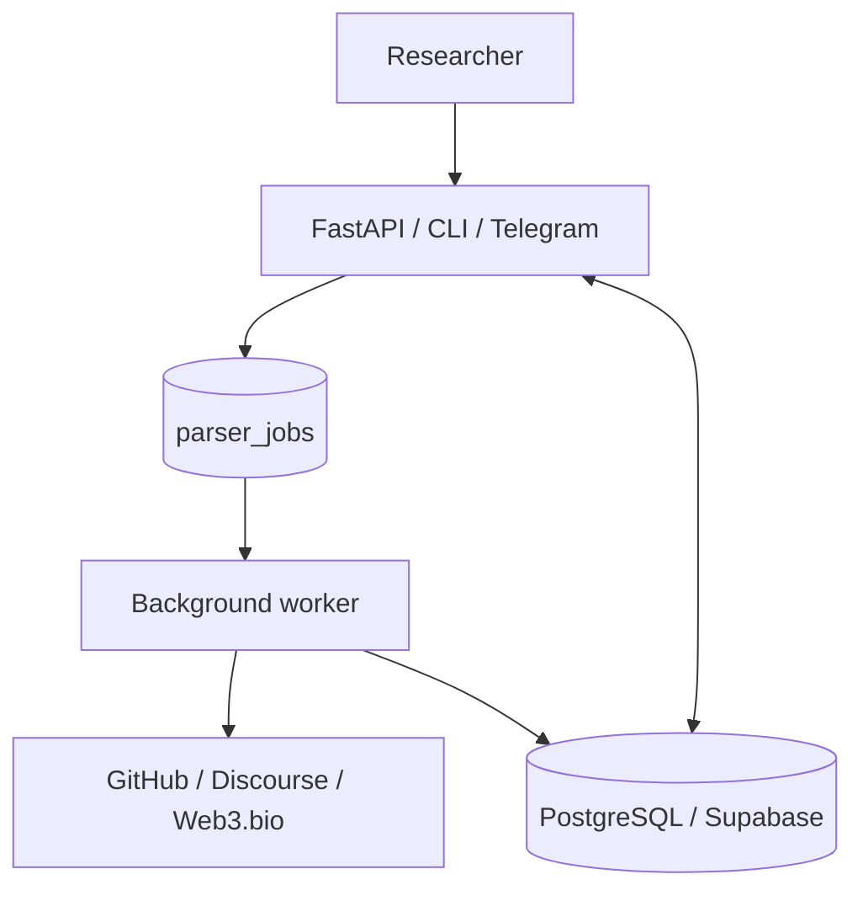
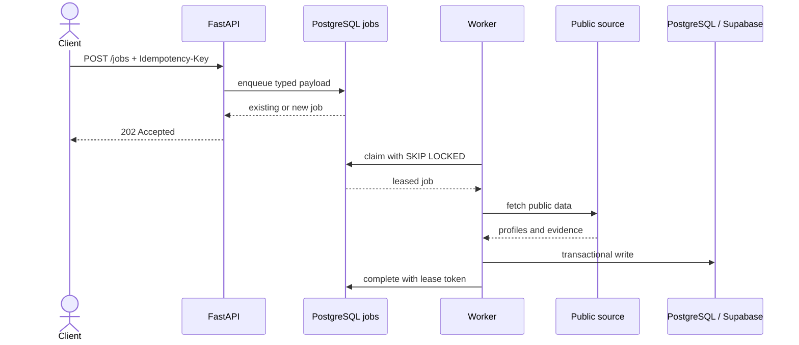
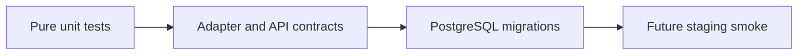

# Architecture and engineering decisions

Документ объясняет устройство Crycon и причины ключевых решений. Он рассчитан на
технический разбор проекта и собеседование.

## System context

Система исследует публичные сигналы. Внешние ответы нормализуются, сохраняются
вместе с evidence и участвуют в эвристическом scoring. Score не является
аутентификацией или доказательством владения аккаунтом/кошельком.

## Layers

| Слой | Ответственность | Примеры |
|---|---|---|
| Pure core | Детерминированные правила без I/O | scoring, normalization, deduplication |
| Application | Сценарии API и typed jobs | routes, payload models, handlers |
| Ports | Контракты application layer | `CandidateRepository` |
| Adapters | Конкретные технологии | Supabase repository, PostgreSQL jobs |
| Entrypoints | Запуск и совместимость | CLI, `worker.py`, Telegram bot |

Главная граница проходит между чистыми правилами и side effects. Поэтому scoring
проверяется без сети, а API — через fake repository.

## Job data flow

HTTP не ждёт внешние API. Повтор с тем же idempotency key получает ту же job.
Lease не позволяет опоздавшему worker завершить задачу после её повторного claim.

## Key decisions

### Incremental extraction instead of a rewrite

Работающие CLI-сценарии и формулы сохранены, а новые границы добавлялись вокруг
них. Это снижает риск незаметно изменить поведение и позволяет сравнивать старую
и новую реализацию regression-тестами.

### Narrow repository port

`CandidateRepository` содержит только общие чтения, нужные API и CLI. Специфичные
pipeline writes не спрятаны в универсальный CRUD: иначе были бы скрыты транзакции
и появился бы интерфейс «на всякий случай».

### PostgreSQL owns atomicity

Discovery раньше делал candidate, profile и evidence тремя REST-вставками. Сбой
оставлял частичные данные. Миграция `004` выполняет всё одной функцией БД: либо
фиксируются все сущности, либо PostgreSQL откатывает операцию.

### Live search instead of a materialized view

Старая view устаревала и размножала candidate из-за произведения связанных строк.
Миграция `003` объединяет сигналы, группирует их по candidate и выбирает максимальный
rank. Компромисс: производительность надо подтвердить `EXPLAIN ANALYZE` на staging.

### Versioned scoring policies

В legacy pipeline существовали разные enrichment и recalculation формулы. Их не
объединили молча: обе получили имена policy, breakdown и regression tests. Score v2
потребует размеченных fixtures и плана миграции сохранённых значений.

### PostgreSQL-backed jobs

Отдельный broker добавил бы инфраструктуру раньше измеренной необходимости.
PostgreSQL уже обязателен и поддерживает атомарный claim через `SKIP LOCKED`.
При росте нагрузки storage adapter можно заменить, не переписывая core/handlers.

## Reliability properties

- enqueue идемпотентен по job type и idempotency key;
- claim атомарен и не выдаёт одну job двум worker;
- heartbeat продлевает lease;
- stale job возвращается в очередь;
- число attempts ограничено, последняя ошибка сохраняется;
- complete доступен только владельцу актуального lease;
- discovery write атомарен на уровне PostgreSQL.

## Test strategy

Unit tests проверяют core и state machines; fake adapters — API без сети;
integration tests — реальные миграции в случайной PostgreSQL schema. Staging пока
остаётся следующим уровнем и не объявляется проверенным.

## Security boundary

Исторически `.env` был закоммичен. Удаление файла из дерева не удаляет секреты
из истории, поэтому все старые значения считаются скомпрометированными. Ротация
и очистка истории разделены. Детали: [SECURITY.md](SECURITY.md).

До публичного запуска также требуются проверенные RLS/grants, quotas, ограничение
Telegram-команд, аудит возвращаемых полей и защита исходящих HTTP-запросов.

## Known limits

- API/test images собраны на Windows/WSL2; worker restart ещё не проверен;
- Supabase schema, backend grants и RLS проверены на отдельном staging; отдельный
  HTTP negative test с publishable key ещё не записан;
- fuzzy search не профилировался на production-like объёме;
- ownership кошелька нельзя заключить только из найденной публичной строки;
- score v1 не откалиброван на размеченном датасете;
- полный worker crash/restart не проверен end-to-end.
